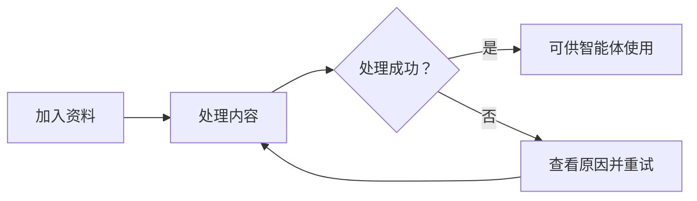

# 产品结构与用户流程

根据仓库中的文档、代码，帮助用户直观理解当前项目的产品/模块。省略开场白，语言简洁。选择能清晰表达要点的最小视图。

## 范围

覆盖页面与组件、用户交互、Default / Empty / Loading / Error 等实际存在的状态、权限造成的界面差异、关键业务流程、文案与反馈。

## 工作方式

### 1. 页面信息架构分析

- 以浅层文件树的形式输出页面信息架构：

```txt
Product 页面架构
├─ 首页
│  ├─ 列表：按来源类型分组、搜索、新建与管理
│  └─ 全览：累计检索次数、来源总数、全局知识图谱
│
├─ 创建
│  └─ ...
│
└─ 详情
   └─ ...
```


### 2. 确定边界与证据

结合页面信息架构，调查实际入口（包括嵌入其他模块的入口）、主要页面及其组成，确认分析对象的任务、边界、关键代码位置。

- 文本块
```markdown
- 核心任务：用户把资料加入知识库，并确认资料已可供使用。
- 分析边界：覆盖文档上传、处理状态查看和删除，不包含知识库配置与对话检索。
- 定位依据：从知识库详情的「文档」页签进入，对应 `/knowledge/:id/documents` 路由及 `KnowledgeDocumentsPage`(apps/example/src/routes/knowledgeDocuments.tsx) 页面。
```

### 3. 提取关键业务流程

拆解关键用户路径和场景，并通过文字箭头、流程图、文本图表等方式输出，帮助用户理解产品行为。

- 文字箭头图表示意
```txt
资料接入 → 知识来源 → 选择引用范围 → 智能体使用
```

- Mermaid 流程图示意


- 文本图表示意
```txt
加入资料
   ↓
处理内容
   ├─ 成功 → 可供智能体使用
   └─ 失败 → 查看原因 → 重试
```

### 4. 组件状态拆解

输出表格：组件 × 状态 × 进入条件 × 可执行动作 × 位置。以便稳定复现重要状态，并找到关键代码位置。

输出示例：
```csv
组件,状态,进入条件,可执行动作,位置
'列表','知识库首页','空状态','无数据','新建/导入',apps/example/src/routes/session.tsx
```


## 内容展示引导

```
## 目标
{确定边界与证据，如核心任务、分析边界、定位依据}

## 页面信息架构

{页面信息架构}

## 用户流程

### 1. {流程一}

{产品行为}

## 状态

{组件状态}


```
